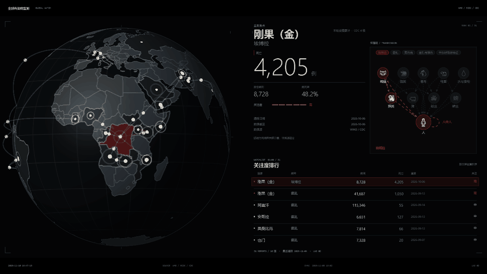

# 全球传染病监测屏保 · Global Disease Watch




地球、关注度排行、传播链，每 9 秒轮播一条。

```powershell
# WPF 屏保（Windows）
powershell -NoProfile -ExecutionPolicy Bypass -File src\build.ps1

# 网页版（任何系统）
python -m http.server 8899 --bind 127.0.0.1 --directory web

# Electron 壳
cd electron; npm i; npm start
```

配色在 `src/WallView.cs` 的 `Th.Use()` 里改。

更新频率在 `feeds.json` 的 `refreshSeconds` 里改（默认 3600）。

数据源接入见 [DATA.md](DATA.md)，限制见 [LIMITED.md](LIMITED.md)。

---

The loop above runs 30 s of the live rotation. The globe, the attention ranking and the transmission chain come round once every nine seconds.

```powershell
# Windows screensaver
powershell -NoProfile -ExecutionPolicy Bypass -File src\build.ps1

# Web (any system)
python -m http.server 8899 --bind 127.0.0.1 --directory web

# Electron shell
cd electron; npm i; npm start
```

Colours live in `Th.Use()` in `src/WallView.cs`.

Update cadence lives in `refreshSeconds` in `feeds.json` (default `3600`).

Data sources: [DATA.md](DATA.md). Limitations: [LIMITED.md](LIMITED.md).
