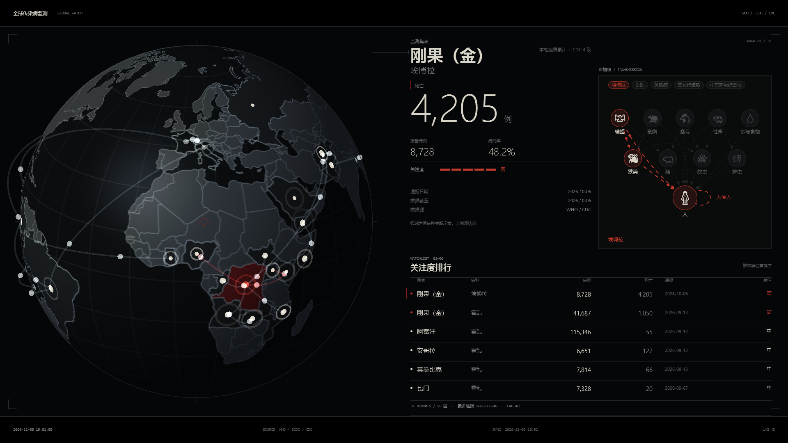
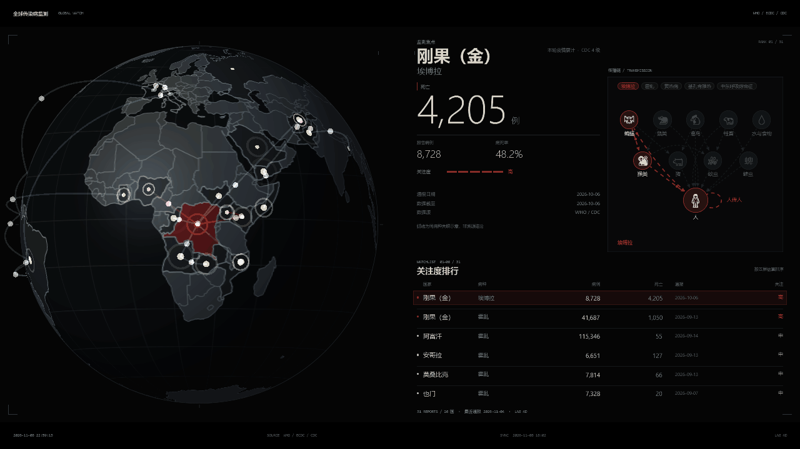
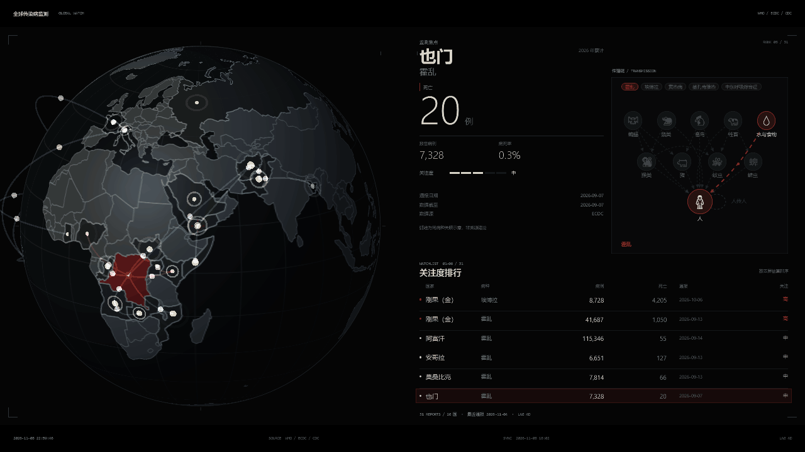
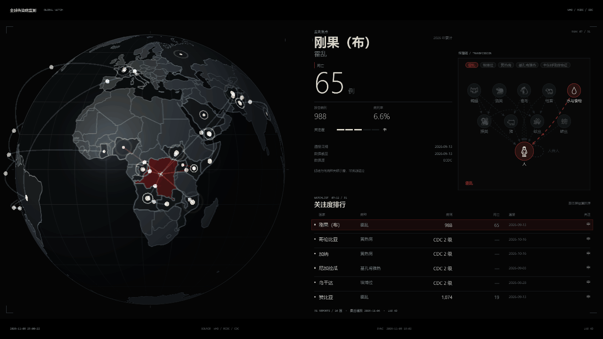

# 全球传染病监测屏保 · Global Disease Watch




每 9 秒切换一条，地球缓动转向，排行跟随翻页。


焦点走到第 6 条后整页翻页，高亮带跟着换到第 2 页首行。


传播链随病种切换：当前病种的宿主路径在九类宿主里高亮。

```powershell
# WPF 屏保（Windows）
powershell -NoProfile -ExecutionPolicy Bypass -File src\build.ps1

# 网页版（任何系统）
python -m http.server 8899 --bind 127.0.0.1 --directory web

# Electron 壳
cd electron; npm i; npm start
```

配色在 `WallView.cs` 的 `Th.Use()` 里改。

更新频率在 `feeds.json` 的 `refreshSeconds` 里改：默认 `3600`（每小时抓一次）。只想改屏上数字刷新节奏，改 `WallView.cs` 里的 `RefreshSecs`（默认 3 秒重读文件）。

数据源接入见 [DATA.md](DATA.md)。

限制见 [LIMITED.md](LIMITED.md)。

```powershell
# Windows screensaver
powershell -NoProfile -ExecutionPolicy Bypass -File src\build.ps1

# Web (any system)
python -m http.server 8899 --bind 127.0.0.1 --directory web

# Electron shell
cd electron; npm i; npm start
```

One report every 9 seconds: the globe eases to the new epicentre and the ranking follows.

When the focus reaches the sixth row the whole page turns, highlight band and all.

The chain follows the disease: the current host path lights up across the nine host classes.

Colours live in `Th.Use()` in `WallView.cs`.

Update cadence lives in `refreshSeconds` in `feeds.json` (default `3600`, once an hour). To change only how often the screen re-reads numbers, edit `RefreshSecs` in `WallView.cs` (3 seconds by default).

Data sources: [DATA.md](DATA.md).

Limitations: [LIMITED.md](LIMITED.md).
